  

 

# 💫 About Me
> **A passionate Python Developer focused on building automated workflows, efficient scripts, and robust backend utilities.**

---

### 🌐 Connect with me

  
  
  

---

### 💻 Tech Stack

  <!-- Core Languages -->
  
  
  
  <!-- Backend & Frameworks -->
  
  
  
  <!-- Automation & Libraries -->
  
  
  
  <!-- DevOps & Deployment -->
  
  
  
  
  <!-- Design -->
  
  

---

### 📊 GitHub Analytics

  
  

  

